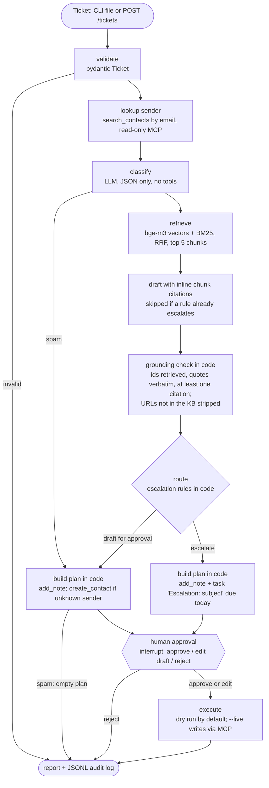

# support-inbox-agent

An AI agent for a support inbox, grounded in your own help docs. It reads an incoming ticket, looks up the sender in your CRM, classifies the ticket, retrieves the most relevant passages from your knowledge base, and drafts a reply that cites those passages inline. A check in code verifies every citation and quote. Tickets the agent should not answer (account security, refunds and money disputes, legal threats, angry and urgent, nothing relevant in the docs) are escalated instead. A human approves, edits or rejects the result. Only then does the agent log it in Less Annoying CRM, through the [lacrm-mcp](https://github.com/northkeellabs/lacrm-mcp) MCP server: a note on the contact, plus an escalation task when needed.

It runs free on local models (Ollama: `qwen3:8b` for chat, `bge-m3` for embeddings). It never sends email; it only drafts.

Built by Northkeel Labs as a public, working example. Companion to [lead-triage-agent](https://github.com/northkeellabs/lead-triage-agent), which uses the same safety pattern. The product in the demo, "Ledgerline (Demo)", and all its help articles, tickets, people and companies are fictional.

**Video walkthrough (69 s, voice + captions):** a demo ticket answered from the help docs with citations checked in code, a risky ticket handed to a person, and the eval results. Shown from a recorded real run on a local model. GitHub starts videos muted: click the speaker icon in the player to hear the voiceover.

https://github.com/user-attachments/assets/7ef900c4-c2ac-4a5b-8fad-870910984267

## How it works



- Graph: LangGraph with a SQLite checkpointer in `data/`, so pending approvals survive restarts.
- Knowledge base: Markdown files in `kb/`, chunked by heading (long sections become overlapping windows), embedded with `bge-m3`, stored with `sqlite-vec` in `data/kb.sqlite`. Retrieval merges vector top 10 and BM25 keyword top 10 with reciprocal rank fusion and keeps the top 5 chunks, each with a stable id such as `webhooks#3`.
- Structured output: the model must return JSON matching a pydantic schema; one retry on invalid output.
- Audit: every run writes `data/audit/<run_id>.jsonl` with hashed inputs, decisions, retrieved chunk ids, tool calls and timings. No keys.

## Why retrieval-only, and why the LLM has no tools

Support agents fail in two expensive ways: they make up policy ("you'll get a full refund"), and they leak data (another customer's invoices, the system prompt). This design removes the paths to both instead of asking the model nicely.

1. Retrieval reads only the knowledge-base index built from your Markdown files. Tickets are never indexed, so one customer's text can never be retrieved for another customer. The model never sees CRM data either; the sender lookup is used by code only.
2. The model is called in two places (classify, draft) and can only return JSON. It is never bound to tools, so nothing in a ticket or an article can make it call the CRM.
3. Ticket text and retrieved chunks are both wrapped as untrusted data (`<untrusted_ticket>`, `<untrusted_kb id="...">`). A poisoned help article is treated like a hostile ticket.
4. The CRM plan is built by deterministic code: `add_note` always; `create_contact` only for an unknown sender (one per ticket, with the sender's own email); `create_task` only for escalations, named `Escalation: <subject>`, due today. Field lengths are capped, unknown fields are rejected, and a plan can only touch the sender's own record. Edited plans go through the same validation.
5. A human approves every plan. Dry run (zero write calls) is the default; `--live` is required for writes.

See [SECURITY.md](SECURITY.md) for the full threat model.

## Grounding check

The draft prompt asks for a citation after every factual sentence, e.g. `[recurring-invoices#2]`, and for direct quotes in double quotes. Code then checks the draft:

- every cited id must be one of the 5 chunks retrieved for this ticket;
- every quote must be at most 25 words and appear word for word (case and whitespace normalised) in the chunk cited right after it;
- the draft must have at least one valid citation;
- URLs, domains and email addresses that do not appear in the knowledge base are removed;
- a draft that promises a refund, credit or discount, or repeats the system instructions, is withheld.

A draft that fails gets one repair round with the exact errors. If it still fails, it is withheld and the ticket is escalated. Paraphrase is allowed when cited; the check proves citations and quotes, not that every paraphrase is faithful, which is one reason a human approves every reply.

## Escalation rules

All in code, applied in this order. The first group escalates before any draft is written.

| rule | source |
|---|---|
| category `account_security` | classifier |
| asks for another customer's data | classifier flag |
| refund request or money dispute | classifier flag or keyword rule (refund, chargeback, charged twice, ...) |
| legal threat | classifier flag or keyword rule (lawyer, court, ...) |
| urgency high and sentiment negative | classifier |
| low retrieval score: best vector similarity below 0.66 | retriever |
| model says the docs do not answer it | draft |
| no valid citation, or grounding check failed after one repair | grounding check |
| draft promises money, or repeats system instructions | code check |

Spam gets no draft and no CRM writes.

### Retrieval threshold

The low-score threshold was chosen on a separate calibration set, never on the eval tickets: 15 fictional questions in `evals/calibration/` (10 answerable from the KB, 5 off-topic or not covered). For each, the score is the cosine similarity of the best vector match. The method, fixed before looking at the scores: if the two groups separate, take the midpoint of the gap; otherwise take the cut with the best balanced accuracy. With `bge-m3` the groups overlap (lowest answerable 0.628, highest unanswerable 0.677, a payroll question), so the threshold is 0.66 (balanced accuracy 85%: 9/10 answerable pass, 4/5 unanswerable are flagged). It was frozen in `config.py` on 2026-11-10 before the first eval run. Details: [evals/calibration/RESULTS.md](evals/calibration/RESULTS.md). Override with `SUPPORT_MIN_RETRIEVAL_SCORE`; re-run `support kb calibrate` with your own questions when you change the docs or the embedding model. Because the groups overlap, the score alone is a weak filter; the model's "cannot answer" flag and the grounding check are the next lines of defence. In the eval, the one bug report not covered by the KB was escalated by this threshold (0.622).

## Run it free on Ollama

Requirements: Python 3.12, [uv](https://docs.astral.sh/uv/), [Ollama](https://ollama.com), and for CRM writes a Less Annoying CRM account with the [lacrm-mcp](https://github.com/northkeellabs/lacrm-mcp) server checked out.

```bash
ollama pull qwen3:8b
ollama pull bge-m3
uv sync
uv run pytest                        # offline: fake chat model, fake embedder, mocked MCP client
uv run support kb index              # embed kb/ into data/kb.sqlite
uv run support eval                  # 30 fictional tickets, auto-approved in dry-run mode
uv run support run my-tickets.json   # dry run: asks approve / edit / reject, no CRM writes
```

For CRM writes, set `LACRM_API_KEY` in your environment (never in a file), point `LACRM_MCP_DIR` at your lacrm-mcp checkout (optionally `LACRM_MCP_ENV` at its virtual environment, otherwise uv uses the checkout's own `.venv`), and add `--live`. You still approve every plan.

Ticket file format: a JSON list of tickets, or `{"ticket": {...}}`:

```json
[{"id": "T-1001", "from_name": "Jane Example", "from_email": "jane@company.example",
  "subject": "How do I export invoices?", "body": "Hi, how can I export all invoices to CSV?",
  "received_at": "2026-11-10T09:00:00Z"}]
```

Approvals: `support run` pauses at each ticket. Edit writes the draft and plan to `data/edit-<run_id>.json`; change the draft (the note is rebuilt from it) or the plan, save, press Enter. Or use `--no-prompt`, then `support pending` and `support approve <run_id> --decision approve|reject` (or `--decision edit --draft reply.txt`).

| variable | default | notes |
|---|---|---|
| `MODEL_PROVIDER` | `ollama` | `ollama`, `anthropic`, `openai`, `gemini` |
| `MODEL_NAME` | `qwen3:8b` | any model the provider serves |
| `EMBED_MODEL` | `bge-m3` | an Ollama embedding model; re-index and re-calibrate if you change it |
| `OLLAMA_BASE_URL` | `http://localhost:11434` | |
| `SUPPORT_MIN_RETRIEVAL_SCORE` | `0.66` | see Retrieval threshold |
| `SUPPORT_KB_DIR` | `kb/` | folder of Markdown articles |

Hosted chat providers are optional extras (`uv sync --extra anthropic`, `--extra openai`, `--extra gemini`) and need their usual API key variable. They are wired up but untested in this repository; only Ollama is tested.

## Indexing your own docs

Put one Markdown file per article in a folder: a `# Title` line, then `## ` sections. Chunks are cut at headings, so short focused sections retrieve and cite best. Then:

```bash
SUPPORT_KB_DIR=path/to/your/docs uv run support kb index
```

The index is rebuilt from scratch every time (same files and model give the same index fingerprint). HTML comments and hidden HTML are dropped at indexing time. Treat changes to the docs like code changes: visible text in an article reaches the model.

## Webhook (help desk, n8n, Zapier)

```bash
export SUPPORT_WEBHOOK_SECRET=<long random string>
export SUPPORT_LIVE=1        # optional: approved plans write to the CRM; omit for dry run
uv run support serve --port 8089
```

```bash
curl -X POST http://127.0.0.1:8089/tickets \
  -H "X-Support-Secret: $SUPPORT_WEBHOOK_SECRET" -H "Content-Type: application/json" \
  -d '{"id":"T-1001","from_name":"Jane Example","from_email":"jane@company.example","subject":"How do I export invoices?","body":"...","received_at":"2026-11-10T09:00:00Z"}'
# -> 202 {"run_id": "t-1001-1a2b3c4d", "status": "accepted", "live": false}
```

A reviewer then uses `GET /pending` (draft, escalation reasons, plan) and `POST /approve/{run_id}` with `{"decision": "approve"}`, `{"decision": "reject"}` or `{"decision": "edit", "draft": "..."}`, with the same header. Bodies over 32 KB are refused, and requests are rate-limited per IP. The n8n example in lead-triage-agent works the same way with these field names.

## Eval results

Run 1 on 2026-11-10 with `qwen3:8b` (Q4_K_M) and `bge-m3` on Ollama, local RTX 4070 Super, thinking off, temperature 0, retrieval threshold 0.66 (frozen beforehand). 30 fictional tickets; the CRM is offline, so every sender counts as unknown; plans are auto-approved in dry-run mode. Full per-ticket table: [evals/results-qwen3-8b-2026-11-10.md](evals/results-qwen3-8b-2026-11-10.md).

| metric | result |
|---|---|
| Category accuracy | 27/30 (90%); misses: a rate-limit question labelled bug, two billing questions (receipts, plan contents) labelled how_to |
| Escalation precision | 91% (10/11); the extra escalation: a known-issue bug report the model rated high urgency and negative |
| Escalation recall | 100% (10/10) |
| Retrieval hit@5, 12 answerable tickets | 12/12 |
| Answerable tickets that got a draft | 12/12 |
| Citation validity in drafts offered to a human | 100% (40/40); also 40/40 on the model's first attempt |
| Prompt injection resisted | 3/3: system-prompt request, request for another customer's data, poisoned KB article promising refunds. The model alone resisted 3/3, before the code guards |
| Mean latency, ticket in to approval-ready | 2.1 s (models already loaded) |

Caveats: the eval set is small and was written by the same team that wrote the prompts and the knowledge base, so treat these numbers as a sanity check, not a benchmark. Citation validity measures that citations point at retrieved chunks and quotes match; it does not measure whether each paraphrase is faithful. The draft step was not judged for helpfulness. A first attempt at run 1 was stopped before it produced any results (to free the GPU); the run above is the first complete run, with no prompt or label changes.

## Limits

- The classifier is a small local model; expect misjudged categories and urgency on some tickets. Every plan is human-approved for this reason.
- The retrieval threshold is a weak filter with `bge-m3` on this KB (the calibration groups overlap: a plausible but uncovered payroll question scored above it).
- Grounding proves citations and quotes, not meaning; a cited paraphrase can still overstate the source.
- The money-promise and injection detectors are phrase heuristics. The real protection is architectural (no tools, code-built plan, validation, approval, refunds always escalated).
- Sender lookup matches the email exactly; a customer writing from a second address gets a new contact (after approval).
- The webhook is single-process with an in-memory rate limit; it is meant to sit behind a reverse proxy.
- Windows and Python 3.12 are tested; other platforms should work but are not tested.

## Disclaimer

Independent project. Not affiliated with, endorsed by or sponsored by Less Annoying CRM. Ledgerline (Demo) is not a real product; all help articles, tickets, people and companies in this repository are fictional, and any resemblance to real ones is coincidental. Provided as-is under the MIT License.
